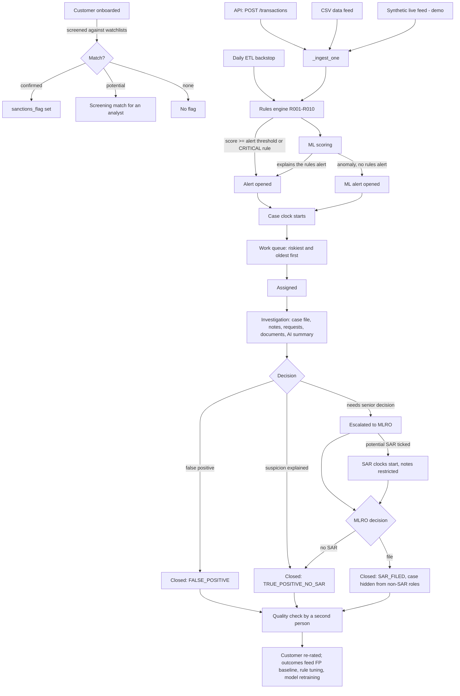

# KYRO AML — From Transaction to Resolution

How a transaction enters KYRO, how it becomes an alert, and how that alert is
investigated, decided and closed. Every step names the code that does it, the
role that may do it, and what is written to the audit log.

> Branch `feature/aml-controls-hardening`. Sprint 4 items (AI attestation, wider masking,
> phonetic screening) are marked **(S4)**: in the working tree, not yet merged.

## The flow at a glance

---

## 0. Before any transaction: the customer

| What happens | Code | Notes |
|---|---|---|
| Customer created or key fields changed (name, date of birth, country, residency) | `services/customer_service.py` | Screening runs automatically |
| Screened against sanctions and PEP lists | `services/screening_service.py: screen_customer` | Score ≥ `SCREENING_CONFIRMED_SCORE` (92): **confirmed match**, `sanctions_flag` set. Score ≥ `SCREENING_POTENTIAL_SCORE` (75): **potential match** for an analyst; the flag is not set |
| **(S4)** Name matching | same | Transliterated from other scripts, common spelling variants unified, searched by primary name, aliases and sound. A name that only *sounds* the same scores 85: review, never confirmed |
| Beneficial owners screened | `services/beneficial_ownership_service.py` | A confirmed match on an owner also flags the company |
| Whole book re-screened every night | `tasks/watchlist_tasks.py` (after the 01:00 list refresh) | |
| Analyst decides a potential match | `PUT /api/v1/screening/{id}/decision` (`screening.run`) | Confirming sets `sanctions_flag` / `pep_flag` |

The flags matter later: rule **R005** fires on PEPs and **R006** on sanctioned customers.

## 1. A transaction arrives

All live paths go through one function, `routers/transactions.py: _ingest_one`, so every
transaction gets the same checks.

| Path | Entry point | Who |
|---|---|---|
| Single or batch API | `POST /api/v1/transactions`, `POST /api/v1/transactions/batch` | `transactions.ingest` |
| Client data feed (CSV, mapped columns, dry run first) | `services/feed_service.py` → `_ingest_one` | `feeds.load` |
| Synthetic live feed (demo only, `SYNTHETIC_FEED_ENABLED`) | `services/live_feed_service.py` → `_ingest_one` | `feeds.load` |
| Safety net for anything loaded around the API | `tasks/etl_tasks.py` (daily, 02:00) → rules engine only | system |

`_ingest_one` checks the customer and account exist and belong together, stores the
transaction, runs **step 2** and **step 3**, and writes `TRANSACTION / CREATE` to the audit log.

## 2. Rules engine

`services/rules_engine.py: apply_to_transaction`

| Rule | Fires when | Severity |
|---|---|---|
| R001 Amount threshold | amount > `AMOUNT_THRESHOLD` (10,000) | MEDIUM |
| R002 Velocity daily | more than `VELOCITY_DAILY_LIMIT` (5) in a day | MEDIUM |
| R003 Velocity hourly | more than `VELOCITY_HOURLY_LIMIT` (3) in an hour | LOW |
| R004 High-risk country | the transaction's country, origin or destination is in `HIGH_RISK_COUNTRIES` | HIGH |
| R005 PEP | customer is a PEP | HIGH |
| R006 Sanctions | customer is flagged as sanctioned | CRITICAL |
| R007 New counterparty | first payment to this counterparty | LOW |
| R008 Weekend | weekend transaction | LOW |
| R009 Round amount | suspiciously round amount | MEDIUM |
| R010 Rapid succession | several transactions within `RAPID_SUCCESSION_WINDOW_SECONDS` (60) | HIGH |

- **Score** = sum of severity weights (LOW 10, MEDIUM 25, HIGH 50, CRITICAL 90), capped at 100.
- **Recommended action:** any CRITICAL rule → `SAR`; score ≥ `EDD_THRESHOLD` (75) →
  `ENHANCED_DUE_DILIGENCE`; score ≥ `ALERT_THRESHOLD` (50) → `REVIEW`; otherwise no alert.
- Each fired rule is kept as a `transaction_risk_flags` row; the transaction keeps its score.
- Thresholds are per jurisdiction (customer's residency, then country, then GLOBAL) and change
  only through **maker-checker**: a Rules Owner proposes with a backtest, the MLRO approves
  (`/api/v1/changes/rules`).

## 3. ML scoring

`services/auto_scoring_service.py: score_ingested` (when `ML_AUTO_SCORE` is on and a model is trained)

- Risk scorer, anomaly classifier and isolation forest score the transaction; an `ml_scores` row is kept.
- If the rules engine opened an alert, the model's explanation (SHAP) is **added to that alert**.
- If not, and the models flag an anomaly, `services/alert_service.py` routes by score:
  ≤ 30 log only; 31–70 alert with `BATCH_REVIEW`; > 70 alert with `IMMEDIATE_REVIEW`.
- Scoring never blocks the transaction: if models are missing or fail, the rules result stands.

## 4. Alert opened

| What | Code |
|---|---|
| Alert row: score, rules fired, recommended action, status `OPEN` | `models/alert.py` |
| **Case clock starts**: target days fixed now by risk band (`CASE_SLA_DAYS`: HIGH 5, MEDIUM 10, LOW 20), `detected_at` recorded | `services/deadline_service.py: start_case_clock` |
| **Customer re-rated**: sanctions 80, SAR in last 12 months 50, PEP 40, open high alert 35 … → LOW ≤ 30 < MEDIUM ≤ 70 < HIGH | `services/customer_risk_service.py` |
| Pushed to open browsers | `GET /api/v1/alerts/stream` (server-sent events) |

One alert is opened per transaction that triggers; **Review Cases** groups them by customer
so one review can settle several.

## 5. Work queue and assignment

| Step | Endpoint | Who |
|---|---|---|
| Queue, highest risk then oldest first; filters for overdue, waiting on information, unassigned, rule | `GET /api/v1/alerts/queue`, `/queue/customers`, `/queue/summary` | `cases.view` |
| Assign one, or several at once | `PUT /alerts/{id}/assign`, `PUT /alerts/bulk-assign` | `alerts.assign` (Team Lead, MLRO) |

Visibility (`app/visibility.py`): L1, L2 and KYC analysts see only their own cases and the
unassigned pool; roles with `cases.view_all` see every case. SAR-filed cases are hidden from
roles without `sar.view` (they get "not found").

## 6. Investigation — the case file

Everything an investigator needs on one page (`frontend/phase3/js/case-detail.js`, `routers/case_file.py`):

| Section | Endpoint |
|---|---|
| Timeline of notes, decisions, documents and requests; case stages; case clock | `GET /alerts/{id}/timeline` |
| Notes (cannot be edited or deleted) | `POST /alerts/{id}/notes` |
| Requests for information, with due dates | `GET/POST /alerts/{id}/requests`, `PUT /alerts/requests/{id}` |
| The customer's earlier cases and how they ended | `GET /customers/{id}/case-history` |
| Activity against the customer's own 90-day baseline; counterparties; accounts | `/customers/{id}/activity`, `/counterparties`, `/accounts-overview` |
| Screening matches to decide | `GET /customers/{id}/screening-matches` |
| KYC documents: upload, AI reading with page citations, accept/edit/reject each field | `/api/v1/documents/...` |
| Why each rule exists: obligation and regulation it implements | `GET /controls/basis` |
| AI case summary | `POST /alerts/{id}/summary` |
| Draft narrative (who, what, when, where, why), kept as versions | `POST /alerts/{id}/draft-narrative`, `GET/POST /alerts/{id}/narratives` |
| Deadlines | `GET /alerts/{id}/deadlines` |

**AI rules.** AI proposes; a person decides. Before any text leaves KYRO, names, contact
details, IDs and **(S4)** addresses, postcodes, references and account numbers are replaced
with placeholders (`app/ai/redaction.py`), and every call is logged in `ai_interactions`.
**(S4)** A summary shows *Not checked* until an investigator confirms it against the records
(keep, correct or reject: `PUT /alerts/{id}/summary/review`); a narrative is saved only with
that confirmation; the decision is recorded on the AI call.

## 7. Decision

`PUT /alerts/{id}/resolve` or `PUT /alerts/{id}/escalate`, always with reason codes and notes.

| Outcome | Meaning | Who may record it | Reasons allowed |
|---|---|---|---|
| `FALSE_POSITIVE` | Not suspicious; the rule fired wrongly | `alerts.close_false_positive` (L1, L2, Team Lead, MLRO) | known counterparty, rule too broad, threshold too low, data quality, duplicate, screening name mismatch, other |
| `TRUE_POSITIVE_NO_SAR` | The activity is real but explained | `alerts.close` (L2, Team Lead, MLRO) | expected activity documented, customer explanation verified, other |
| `ESCALATED` | Needs the MLRO | `alerts.escalate` (L1, L2, KYC, Team Lead, MLRO) | structuring, layering, sanctions exposure, unexplained source of funds, other |
| `SAR_FILED` | A SAR is filed, with its reference | `sar.approve` (**MLRO only**) | as for escalation |

**Potential SAR.** Ticking *Potential SAR* when escalating:

- starts the **MLRO decision clock** (`SAR_DECISION_DAYS`, proposed 5 days) and the **filing
  deadline** from the date of detection (`SAR_FILING_DAYS`, proposed 30 days; null where the
  jurisdiction sets none). Values must be confirmed by Compliance;
- **restricts the case** (`services/sar_confidentiality.py`): roles without `sar.view` still see
  the case, as *With the MLRO*, but not the escalation notes and reasons, later notes, later
  summaries or any narrative. Nothing they see mentions a SAR.

## 8. MLRO decision and SAR filing

- The MLRO's dashboard lists escalations awaiting a decision, open potential SARs, overdue
  decisions and filings due within 7 days or overdue (`GET /api/v1/dashboard/my-work`).
- **(S4)** A SAR cannot be recorded while the latest narrative is an unchecked AI draft.
- Recording `SAR_FILED` closes the case. From then on it, its documents and the fact a SAR
  was filed are invisible to roles without `sar.view`. Each opening of the case by someone who
  can see it writes `SAR / VIEW` to the audit log.
- The customer's rating rises (SAR in the last 12 months).

## 9. Quality check

`PUT /alerts/{id}/qa` (`alerts.qa`: QA Reviewer, MLRO) records PASS or FAIL with notes on a
resolved case. It never changes the outcome, and nobody may check a case they resolved.

## 10. After closure

| Effect | Where |
|---|---|
| Customer re-rated on every resolution | `customer_risk_service.assess_customer` |
| False-positive rate, time to disposition, per rule | `GET /alerts/disposition-baseline` |
| Rule tuning: propose → backtest → second-person approval → effective date | `/api/v1/changes/rules` |
| Model retraining on analyst outcomes (weekly check) | `tasks/ml_tasks.py`, `POST /api/v1/ml/train` |
| **(S4)** How often investigators accepted, corrected or rejected each AI prompt's output | `GET /api/v1/ai/oversight` |

## Deadlines, side by side

| Clock | Starts | Length | Shown to |
|---|---|---|---|
| Case SLA | alert opened | `CASE_SLA_DAYS` by risk band, fixed when the alert opens | everyone who sees the case |
| MLRO decision | escalated as potential SAR | `SAR_DECISION_DAYS` | `sar.view` roles |
| SAR filing | date of initial detection | `SAR_FILING_DAYS` | `sar.view` roles |

A case is **overdue** when its SLA or its MLRO decision date has passed. All values are
policy, changed through maker-checker (`/api/v1/changes/rules`), globally or per jurisdiction.

## Access outside a role

| Need | How | Control |
|---|---|---|
| An administrator must read one case (e.g. a data fault) | `POST /api/v1/access/emergency` with a reason and duration | MLRO approves; read-only; expires (max 240 min); every read audited as `EMERGENCY_ACCESS / VIEW` |
| Someone needs a role that can see SAR cases | Change the role in Administration | Waits for the MLRO's approval; requester and recipient cannot approve |

## What the audit log records along the way

| Step | Entry |
|---|---|
| Transaction stored | `TRANSACTION / CREATE` |
| Assignment, escalation, decision, QA, summary review | `ALERT / UPDATE`, `APPROVE`, `REVIEW` |
| Customer re-rated, screening decision | `CUSTOMER / UPDATE`, `REVIEW` |
| SAR case opened by an authorised role | `SAR / VIEW` |
| Emergency access asked, decided, used, ended | `EMERGENCY_ACCESS / CREATE`, `APPROVE`/`REJECT`, `VIEW`, `UPDATE` |
| Rule or policy change proposed, approved, activated | `RULE_CONFIG_CHANGE / ...`, `RULE_CONFIG / ...` |
| Every AI call | `ai_interactions` table (redacted input, output, prompt version, human decision) |

Roles and permissions in full: [`ROLE_PERMISSION_MATRIX.md`](ROLE_PERMISSION_MATRIX.md).
