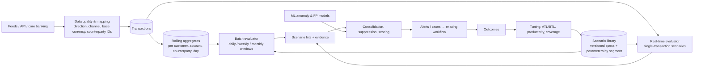

# KYRO Rules Engine — Enterprise Transaction Monitoring Plan

**Status:** Draft for review by Compliance and Engineering
**Scope:** Replace the ten fixed rules (R001–R010) with a governed, segment-aware scenario library that an
examiner can follow from risk assessment to alert, and that a bank can tune, test and run at volume.
**Builds on:** rule configs and maker-checker (`/api/v1/changes/rules`), obligations-to-controls mapping, deadline
and screening policies, ML scoring (`app/ml/`), the case workflow in `docs/TRANSACTION_TO_RESOLUTION_WORKFLOW.md`.

---

## 1. What "enterprise ready" means for a rules engine

From regulator and industry guidance (sources in §12), a transaction monitoring programme is judged on six things.
Each becomes a requirement here.

| # | Expectation | Where it comes from | Requirement for KYRO |
|---|---|---|---|
| E1 | Scenarios follow from the institution's own risk assessment: products, customers, geographies, and national AML/CFT priorities | FFIEC manual (filtering criteria from higher-risk products, customers, geographies; "reasonable and expected" per account type); FATF R.1; FinCEN 2024 AML/CFT programme proposal (mandatory risk assessment, priorities) | A coverage map: risk → typology → scenario → obligation, with gaps visible |
| E2 | Logic, parameters, thresholds and assumptions are documented | NYDFS Part 504 (system documentation of assumptions, parameters, thresholds) | Every scenario is a versioned specification, not code; documentation is generated from it |
| E3 | Thresholds are set and re-tuned by a documented, data-driven method, reviewed periodically | Practitioner standard (above/below-the-line testing on ~12 months of data); OCC enforcement practice | Built-in ATL/BTL testing, sample sizing, productivity metrics per scenario and segment |
| E4 | Pre- and post-implementation testing, data mapping and data-quality checks | NYDFS Part 504 (end-to-end testing incl. data mapping, transaction coding, scenario logic, input and output) | Shadow mode, regression suite of known typologies, source-to-engine reconciliation |
| E5 | Independent validation and model risk management in proportion to influence | SR 26-2 (April 2026, replaced SR 11-7) — see `COMPLIANCE_AI_PLAN.md` §9.5; Wolfsberg Part II (validation, explainability) | Validation pack per scenario; champion/challenger; explainable alerts |
| E6 | Effectiveness is measured by outcomes, not alert or SAR volume | Wolfsberg Statement on Effective Monitoring (2024) | Metrics: alert-to-case, case-to-SAR, time to decision, coverage; not raw alert counts |

## 2. Today's engine — audit of R001–R010

`app/services/rules_engine.py: evaluate()` runs ten Python `if` statements on each transaction as it arrives.

| Rule | What it does | Problem | Recommendation |
|---|---|---|---|
| R001 Amount threshold | amount > 10,000 | **Ignores currency**: 10,001 JPY trips the same threshold as 10,001 USD. No segment difference (a corporate payroll and a student account share one limit) | Compare in base currency; per-segment thresholds; keep as "large transaction" scenario |
| R002 / R003 Velocity daily / hourly | count of transactions in 24 h / 1 h | Counts, not value; same limit for every customer; no direction | Fold into profile-deviation scenarios (count *and* value, vs own baseline and peers) |
| R004 High-risk country | country, origin or destination in a static list | One list for all purposes; no corridor or aggregation; single small payment alerts | Geography risk tiers from the risk assessment; aggregated value to high-risk corridors per period |
| R005 PEP | customer is a PEP | **Fires on every transaction** of a PEP: an attribute, not behaviour. Floods the queue | Remove as a standalone alert; use PEP as a segment and priority factor; add "PEP large / unusual transaction" scenario |
| R006 Sanctions | customer is flagged | Same flood; and a sanctioned customer should be **blocked and escalated once**, not alerted per payment | Move to screening: a confirmed hit opens one sanctions case and holds payments; add counterparty screening on payment |
| R007 New counterparty | first payment to a counterparty name | Name text only (no account/bank); fires constantly for active customers; weak alone | Keep as a factor; scenario "new counterparty + high value + high-risk geography" |
| R008 Weekend | Saturday or Sunday | Not an AML indicator on its own; noise | Remove as a rule; at most a scoring factor for segments where it is unusual |
| R009 Round amount | multiple of 1,000 | Weak alone; noise | Factor in structuring and profile scenarios only |
| R010 Rapid succession | another transaction within ±60 s | Counts future transactions in batch loads; catches batch files, not layering | Replace with rapid movement of funds (in → out within days, low residual balance) |

**Structural limits**
- One alert per triggering transaction: no consolidation, no suppression, no "already under review".
- Score is a sum of severity weights capped at 100: says nothing about *how far* over a threshold, or customer risk.
- No notion of direction (credit/debit), channel (cash, wire, ACH, card, cheque, crypto) or base-currency value: the
  core typologies (structuring, funnel, pass-through) **cannot be detected** without them.
- Thresholds vary only by jurisdiction; no customer segment or peer group; no comparison with KYC expected activity.
- Logic lives in Python; only thresholds are data. An alert does not record which rule version and parameters produced it.
- Every rule runs synchronously inside the ingestion request with its own queries; aggregation scenarios over 30–90
  days cannot run there.
- Backtesting covers only `AMOUNT_THRESHOLD`.

## 3. Target architecture



### 3.1 Scenario specification (logic as data)

A scenario is a versioned record, edited through maker-checker, not a Python `if`:

```yaml
code: STR-01
name: Cash structuring below the reporting threshold
typology: STRUCTURING
regulatory_basis: [31 CFR 1010.314, FinCEN FIN-2012-A006]   # links to the obligations module
mode: batch            # realtime | batch
schedule: daily
population: {channels: [CASH], direction: CREDIT, segments: [RETAIL, SME]}
window: {days: 10}
logic:                 # a small, safe expression language over aggregates; no arbitrary code
  all:
    - count(amount_base between p.band_low and p.band_high) >= p.min_count
    - sum(amount_base) >= p.aggregate_min
    - max(amount_base) < p.single_max
parameters:            # defaults; overridden per segment and jurisdiction
  band_low: 8000
  band_high: 9999
  min_count: 3
  aggregate_min: 15000
  single_max: 10000
priority: HIGH
evidence: [transactions_in_window, branches, depositors]
suppression_days: 30
```

- **Engine:** evaluates the expression language against a transaction (real-time) or an aggregate set (batch).
  Expressions are parsed and validated; no `eval`.
- **Every hit stores** scenario code, version, the parameter values used, the segment, the window and the evidence
  transaction IDs. An examiner can reproduce any alert.
- **Lifecycle:** DRAFT → TESTING (shadow) → APPROVED (second person) → LIVE → RETIRED. Live versions are immutable.

### 3.2 Data foundation (prerequisite for most scenarios)

| Field | Why | Source |
|---|---|---|
| `direction` (CREDIT/DEBIT) | in vs out; pass-through, funnel | feed mapping |
| `channel` (CASH, WIRE, ACH, CARD, CHEQUE, INTERNAL, CRYPTO) | cash typologies; CTR | feed mapping; transaction codes table |
| `amount_base` + FX rate used | one threshold across currencies | daily FX rates table |
| counterparty account, bank BIC, country, name | network and corridor logic; counterparty screening | payment message |
| branch / location / device | funnel accounts, multi-location deposits | channel data |
| originator vs depositor (third-party cash) | funnel accounts | branch systems |

Plus: transaction-code mapping table per source, mandatory-field checks, and a daily **reconciliation** of counts and
totals per source against what the engine evaluated (E4).

### 3.3 Segmentation and expected activity

- **Segments** from customer data: retail individual, high-net-worth, sole trader, SME, corporate, fund, MSB / payment
  provider, non-profit, correspondent. Parameters are set per segment (and jurisdiction).
- **Peer groups** within segments (e.g. by declared turnover band, industry code); refreshed quarterly; clustering
  offered as an option, reviewed by Compliance before use.
- **Expected activity** from KYC (declared monthly volume, typical counterparties and countries) compared with actual.
  Breaches feed a profile-deviation scenario and periodic reviews.

### 3.4 Alert generation: consolidate, suppress, score

- **Consolidation:** hits for the same customer within a window become one alert listing every scenario and
  transaction, instead of one alert per transaction.
- **Suppression:** the same scenario on the same customer does not re-alert within `suppression_days` while a case is
  open or was just closed as explained — **unless** the new activity is materially larger (configurable ratio).
  Every suppressed hit is still stored and visible on the case.
- **Scoring for priority, not for filtering:** strength of each hit (how far over threshold), customer risk rating,
  scenario priority, number of distinct typologies, ML anomaly score. Low score orders the queue; it never deletes a hit.

### 3.5 Processing modes and scale

| Mode | Scenarios | How |
|---|---|---|
| Real-time (seconds) | large single transaction, high-risk corridor payment, counterparty sanctions hit, PEP unusual payment | evaluated on ingestion, from pre-computed aggregates only |
| Batch (daily) | structuring, rapid movement, funnel, profile deviation, new-account activity | over a per-customer/day aggregates table |
| Batch (weekly / monthly) | peer-group outliers, dormant reactivation, expected-activity breach | same |

- Ingestion stops running scenario queries inline; it updates **incremental aggregates** (customer × day × channel ×
  direction × country) and queues real-time evaluation. Batch runs are idempotent, resumable and logged per run.
- Monthly **partitioning** of transactions; aggregates indexed by customer and day.
- **Replay**: any scenario version can be run over any historical period without creating alerts (for tuning and
  validation).
- Indicative targets to validate in performance testing: real-time evaluation p95 < 200 ms; daily batch over 10 million
  transactions inside a 2-hour window.

## 4. Scenario library (target set)

Grouped by typology. "Data" marks what §3.2 must supply first. Priorities follow FinCEN's national AML/CFT priorities;
Compliance confirms the set against the institution's risk assessment.

| Code | Scenario | Logic (summary) | Mode | Data |
|---|---|---|---|---|
| **Cash and structuring** |||||
| STR-01 | Cash structuring below reporting threshold | several cash credits just under the CTR threshold within days, aggregate above it | daily | channel, base amount |
| STR-02 | Structuring across accounts / branches | same as STR-01 across the customer's accounts or several branches | daily | branch |
| CSH-01 | Large cash | cash in or out above segment threshold (supports CTR filing) | real-time | channel |
| FUN-01 | Funnel account | cash deposits by several depositors or locations into one account, followed by withdrawals/wires elsewhere | daily | branch, depositor |
| **Movement of funds** |||||
| RMF-01 | Rapid movement of funds | ≥ X% of credits leave within N days; low residual balance | daily | direction |
| RMF-02 | Pass-through / layering | many credits from different senders, few large debits (many-to-one-to-few) | weekly | counterparty IDs |
| CON-01 | Counterparty concentration | one counterparty receives/sends an unusual share of value | weekly | counterparty IDs |
| **Geography** |||||
| GEO-01 | High-risk corridor value | aggregate value to/from high-risk tiers above segment threshold in period | daily | country tiers |
| GEO-02 | New high-risk geography | first payment to a high-risk country for this customer, above minimum | real-time | country tiers |
| **Behaviour vs profile** |||||
| PRF-01 | Deviation from own baseline | value or count in period ≫ customer's trailing 90-day norm (z-score / ratio) | daily | aggregates |
| PRF-02 | Peer-group outlier | value or count ≫ peer group | monthly | peer groups |
| PRF-03 | Expected-activity breach | actual monthly turnover above KYC-declared level by X% | monthly | KYC expected activity |
| DOR-01 | Dormant account reactivation | no activity for N months, then high value | daily | — |
| NEW-01 | New account high activity | account < 90 days old with value above segment threshold | daily | — |
| **Customer-risk overlays** |||||
| PEP-01 | PEP unusual transaction | PEP customer with a transaction above a PEP-specific threshold or to a new high-risk country (replaces R005) | real-time | — |
| SAN-01 | Counterparty screening hit | counterparty name/BIC/account matches a sanctions list at payment time (complements customer screening; replaces R006 alerts) | real-time | counterparty fields |
| **Typology-specific (enable by risk assessment)** |||||
| MUL-01 | Money mule pattern | young account, many small inbound from unrelated payers, quick outbound | daily | counterparty IDs |
| EFE-01 | Elder financial exploitation | sudden large outflows from an older customer's long-stable account to new payees | daily | date of birth |
| TBML-01 | Trade-based laundering indicators | payments inconsistent with stated trade (needs trade data) | batch | trade data |
| SEC-01 | Securities: in-out without investment | funds deposited and withdrawn with little trading (for `TRADE` accounts) | weekly | trading data |

Weekend activity, round amounts and first-time counterparty become **scoring factors** inside these scenarios, not
alerts on their own.

## 5. Governance and tuning

1. **Coverage map** (E1): each risk in the risk assessment → typologies → scenarios → obligations. Gaps listed on a
   Compliance dashboard. Built on the existing obligations ↔ controls mapping.
2. **Change control** (E2): scenario logic, parameters, segments and suppression go through the existing maker-checker
   flow, with effective dates; every live version is kept.
3. **Tuning method** (E3), per scenario and segment, at least annually and after material change:
   - productivity: alerts → cases escalated → SARs; false-positive reasons from dispositions;
   - **below-the-line**: lower the threshold, replay 12 months, sample the extra alerts with a statistically sized
     sample (e.g. 95% confidence), reviewed blind by analysts;
   - **above-the-line**: raise it, sample the alerts that would be lost, confirm none were productive;
   - write-up generated from the run: data period, parameters, sample, findings, decision, approver.
4. **Testing** (E4): shadow mode for new or changed scenarios (hits recorded, no alerts) for a set period; a regression
   suite of synthetic typology cases per scenario (`generator/` extended with structuring, funnel, rapid movement,
   mule patterns); data reconciliation per run.
5. **Validation** (E5): validation pack per scenario (conceptual soundness, data, logic, outcomes analysis) for the
   independent validator; champion/challenger runs for replacements; alerts explain which conditions fired with values.
6. **Effectiveness reporting** (E6): coverage, productivity, time to decision, backlog age, tuning status; an annual
   programme report that supports board certification where required (e.g. NYDFS Part 504).

## 6. Phased roadmap

| Phase | Deliverables | Exit criteria |
|---|---|---|
| **R1 — Fix and stabilise** (2 sprints) | Base-currency amounts with FX table; stop per-transaction PEP/sanctions alerts (customer-level case instead); weekend/round amount demoted to factors; alerts record rule version + parameters + evidence; consolidation per customer per day | Alert volume on sample data falls; no lost true positives in the regression set |
| **R2 — Data foundation** (2–3 sprints) | `direction`, `channel`, counterparty IDs, branch; transaction-code mapping per source; data-quality checks and daily reconciliation | Every live source mapped; reconciliation report clean for 30 days |
| **R3 — Scenario engine** (3 sprints) | Scenario spec + safe expression language; real-time and batch evaluators; daily aggregates table; replay; lifecycle with shadow mode | R001–R010 re-expressed as specs with identical results in replay |
| **R4 — Core library** (3 sprints) | STR-01/02, CSH-01, RMF-01/02, GEO-01/02, PRF-01, DOR-01, NEW-01, PEP-01, SAN-01; segments; suppression; priority scoring | Each scenario passes its typology regression tests; shadow run reviewed by Compliance |
| **R5 — Tuning and governance** (2 sprints) | ATL/BTL tooling with sample sizing; productivity dashboard; coverage map; generated documentation packs | One full tuning cycle documented and approved |
| **R6 — Advanced** (ongoing) | Peer groups, expected-activity breach, funnel, mule, network (graph) scenarios; ML-assisted prioritisation as challenger | Validated under the model risk framework before use |

## 7. Decisions needed before R1

1. Base currency and FX source.
2. Customer segments and who owns their parameters.
3. Suppression policy (days; what counts as "materially worse").
4. Whether sanctioned-customer payments are **held** in KYRO or only alerted (depends on integration with the payment system).
5. Which typology scenarios are in scope for the first release, from the institution's risk assessment.
6. Tuning frequency and sample confidence level.

## 8. Risks

| Risk | Mitigation |
|---|---|
| Missing source data (channel, direction) blocks the core typologies | R2 before R4; scenarios declare required fields and refuse to run without them |
| Removing R005/R006/R008 per-transaction alerts is seen as reducing coverage | Replay shows every true positive still alerts through PEP-01, SAN-01 and screening; Compliance signs off |
| Expression language grows into a programming language | Fixed function set, reviewed additions only, validated at save |
| Batch windows miss intraday urgency | Real-time scenarios for the urgent cases (sanctions, large cash, high-risk corridor) |
| Thresholds copied from vendors or blogs without calibration | Defaults marked as starting points; first tuning cycle before go-live |

## 9. Sources

Regulatory and industry (accessed 11 Oct 2026; secondary sources are flagged and should be checked against the
primary text before policy is set):

- FinCEN Advisory FIN-2012-A006, funnel accounts — https://www.fincen.gov/resources/advisories/fincen-advisory-fin-2012-a006
- FFIEC BSA/AML Examination Manual, assessing compliance — https://bsaaml.ffiec.gov/manual/AssessingComplianceWithBSARegulatoryRequirements/04
- FinCEN AML/CFT programme proposed rule, June 2024 (summary, Mayer Brown) — https://www.mayerbrown.com/en/insights/publications/2024/07/fincen-proposes-rule-reinforcing-financial-institutions-duty-to-design-and-maintain-risk-based-aml-cft-programs
- Wolfsberg Statement on Effective Monitoring for Suspicious Activity (Part I, 2024) — https://antiriciclaggiocompliance.it/app/uploads/2024/07/The-Wolfsberg-Group-Statement-on-Effective-Monitoring-for-Suspicious-Activity-.pdf
- Wolfsberg Statement Part II: Transitioning to Innovation (2025) — https://wolfsberg-group.org/resources/202
- NYDFS Part 504 practitioner guidance (Corporate Compliance Insights; KPMG) — https://www.corporatecomplianceinsights.com/practical-steps-compliance-nydfs-regulation-part-504/ , https://assets.kpmg.com/content/dam/kpmg/us/pdf/2017/08/roadmap-to-certification.pd.pdf
- Above/below-the-line testing (practitioner: Abrigo; Sphinx) — https://www.abrigo.com/blog/optimizing-your-aml-program-with-above-the-line-below-the-line-testing/ , https://sphinxhq.com/blog-posts/aml-model-validation-requirements
- Scenario tuning (Protiviti) — https://www.protiviti.com/SG-en/insights/tuning-suspicious-transaction-monitoring-scenarios-combining-aml-expertise-and-data
- Expected transaction profile by client group (Dutch Banking Association) — https://www.nvb.nl/media/4afn0d34/nvb-baseline-expected-transaction-profile-etp-en.pdf
- Structuring scenario design (SAS) — https://support.sas.com/resources/papers/proceedings19/3637-2019.pdf
- Core scenario sets (Flagright, vendor) — https://www.flagright.com/insight/monitoring-scenario
