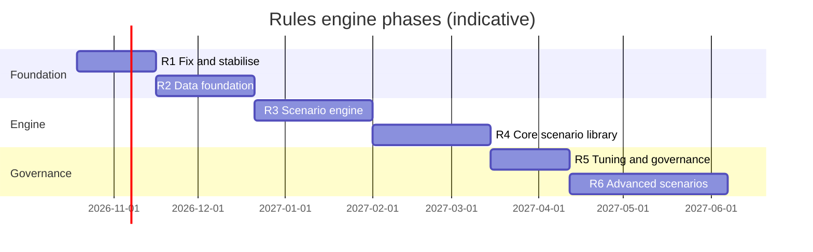

# Rules Engine — Implementation Plan by Phase

**Companion to:** `RULES_ENGINE_ENTERPRISE_PLAN.md` (the *what* and *why*). This document is the *how*: for each
phase, the tasks, files, migrations, data structures, APIs, screens, tests, rollout steps and exit criteria.
**Branch:** one branch per phase off `feature/aml-controls-hardening` (e.g. `feature/rules-r1-stabilise`).
**Migrations:** continue from `0027` (0026 is the last one in the AML controls sprints).
**Estimates:** sprints of two weeks for one backend and one frontend engineer, with a Compliance reviewer
available. They are planning figures, to be re-estimated at each phase start.

R2 can start in parallel with R1 if a second backend engineer is available; R3 depends on R2's fields only for the
scenarios that use them, so the engine itself can be built alongside the end of R2.

---

## Cross-cutting rules (apply to every phase)

| Topic | Rule |
|---|---|
| Feature flags | Every behaviour change ships behind a setting (`RULES_*` in `app/config.py`, documented in `.env.example`), default **off** until Compliance signs off; removed one phase later |
| Shadow first | New or changed detection runs in shadow (hits stored, no alerts) before it creates alerts |
| No silent loss | Every change to detection is replayed over history first; any true positive (case escalated or SAR) that would no longer alert blocks the change |
| ML coupling | `app/ml/training/trainer.py` labels anomalies as `risk_score >= ALERT_THRESHOLD`, i.e. from the rules engine's score. Any phase that changes scoring must freeze the training label definition (store it with the model version) and retrain only deliberately |
| Audit | Every scenario, parameter and lifecycle change goes through maker-checker and the audit log, as rule configs do today |
| Docs | `docs/ROLE_PERMISSION_MATRIX.md` regenerated when permissions change; scenario documentation generated from the specification (R5) |
| Tests | Unit tests per rule or scenario, a typology regression set, and the endpoint inventory test (`tests/api/test_role_matrix.py`) kept green |

---

## R1 — Fix and stabilise (2 sprints)

**Objective:** remove the defects and the noise in today's ten rules without changing the engine's design, and make
every alert reproducible.

### Tasks

| # | Task | Files | Notes |
|---|---|---|---|
| 1.1 | **FX rates and base currency** | new `app/models/fx_rate.py` (`fx_rates`: date, currency, rate_to_base, source); migration `0027_fx_rates`; `app/services/fx_service.py` (`to_base(amount, currency, on_date)`); daily Celery task to load rates; setting `BASE_CURRENCY` | Missing rate → use the latest earlier rate and record `fx_stale=true` on the evaluation; never skip the rule |
| 1.2 | `transactions.amount_base` + `fx_rate_used` | migration `0027`; `rules_engine.apply_to_transaction` fills them; backfill job for history | R001/R009 compare `amount_base` |
| 1.3 | **Stop per-transaction PEP and sanctions alerts** | `rules_engine.py`: R005/R006 no longer add to the score of every transaction; flag `RULES_LEGACY_PEP_SANCTIONS_PER_TXN` (default on for one release) | Sanctions: a confirmed customer hit opens **one** customer-level sanctions alert (in `screening_service` when the flag is first set), not one per payment. PEP stays a risk factor (customer rating) until PEP-01 exists in R4 |
| 1.4 | **Demote weak indicators** | R008 (weekend), R009 (round amount), R007 (new counterparty) no longer count towards the alert threshold on their own: they add to the score only when a substantive rule (R001–R004, R010) also fired | Keeps their information on the alert as "contributing factors" |
| 1.5 | **R010 looks backwards only** | window `[t - 60 s, t]` | Today it also counts later transactions in a batch load |
| 1.6 | **Alert provenance** | migration `0028_alert_provenance`: `alerts.rule_version` (hash of the effective config), `alerts.parameters` (JSONB snapshot of the thresholds used), `alerts.evidence_transaction_ids` (array) | Shown on the case page under "Why this alert" |
| 1.7 | **Consolidation per customer per day** | `rules_engine.apply_to_transaction`: if the customer already has an OPEN/ASSIGNED alert from the rules engine created today, append the transaction and rules to it (update score to the max) instead of opening another | Setting `RULES_CONSOLIDATE_DAILY`; the case timeline shows each added transaction |
| 1.8 | **Freeze the ML label** | `trainer.py`: label definition stored in the model registry metadata; retrain gate requires an explicit approval when it changes | Prevents R1 from silently changing what the ML model learns |
| 1.9 | Replay harness (minimal) | `app/services/rules_replay.py`: re-run `evaluate()` over a date range with a given config, in a rolled-back transaction, and return per-rule counts and the alerts that would differ | Used for the "no silent loss" check; reused by R3 |

### Tests
- Unit: R001 in JPY/EUR/GBP vs USD; stale FX; R010 with a later transaction in the same batch (no hit);
  weak indicators alone (no alert) and with R001 (alert, factors listed); consolidation (two triggering
  transactions same day → one alert, two evidence IDs).
- Replay: on the demo dataset, compare alerts before/after R1; every escalated or SAR case still alerts.
- Existing suite green (`tests/api/test_rules_engine.py`, `test_transactions.py`, `test_alerts.py`, feeds).

### Rollout
1. Ship with flags off; run replay on the last 12 months; Compliance reviews the difference report.
2. Turn on 1.1/1.2 (currency) first; then 1.3–1.5; then 1.7 consolidation.

### Exit criteria
- No alert depends on a non-base-currency comparison.
- PEP/sanctions customers no longer produce one alert per payment; the sanctions case opens once.
- Every new alert carries rule version, parameters and evidence.
- Replay shows zero lost true positives; alert volume change reported with numbers.

---

## R2 — Data foundation (2–3 sprints)

**Objective:** give the engine the fields the real typologies need, and prove the data is complete.

### Tasks

| # | Task | Files | Notes |
|---|---|---|---|
| 2.1 | New transaction fields | migration `0029_transaction_dimensions`: `direction` (CREDIT/DEBIT), `channel` (CASH, WIRE, ACH, CARD, CHEQUE, INTERNAL, CRYPTO, OTHER), `counterparty_account`, `counterparty_bank_bic`, `counterparty_country`, `branch_id`, `depositor_name`, `reference` | `schemas/transaction.py` `TransactionCreate` gains them as optional; `meta_*` kept for compatibility |
| 2.2 | Derivation for old data | `direction` from `transaction_type` (DEPOSIT→CREDIT, WITHDRAWAL→DEBIT, TRANSFER/FX/TRADE→unknown); `channel` unknown | Backfill job; scenarios that need a field skip rows where it is unknown and count them |
| 2.3 | **Transaction code mapping per source** | `app/models/txn_code_map.py` (`source_system`, `source_code` → `transaction_type`, `direction`, `channel`); admin screen to edit; maker-checker | Most core-banking feeds give codes, not channels |
| 2.4 | Feed mapping | `feed_service.py` field list: add the new fields with header aliases ("debit/credit", "dr/cr", "channel", "payment method", "BIC", "IBAN", "branch") | Dry run shows unmapped codes |
| 2.5 | **Data-quality checks** | `app/services/data_quality_service.py`: mandatory fields per source, value ranges, unknown codes, future dates, duplicates (same source + reference) | Results per load run in `feed_runs` |
| 2.6 | **Reconciliation** | `dq_reconciliations` table: per source per day, count and sum received vs stored vs evaluated by the engine; Celery task; dashboard tile | E4 in the enterprise plan |
| 2.7 | Customer segment | migration `0030_customer_segment`: `customers.segment` (RETAIL, HNW, SOLE_TRADER, SME, CORPORATE, FUND, MSB, NPO, CORRESPONDENT); derivation rules from `customer_type` and metadata; editable by KYC | Needed by R4 parameters |
| 2.8 | Expected activity | `customer_expected_activity` (monthly value/count in and out, cash share, countries) captured at onboarding/review | Used by PRF-03 in R6; capture starts now |
| 2.9 | Synthetic data | `generator/data_generator.py` and `sample_feed_service.py` emit direction, channel, branch, counterparty account | So demos and tests exercise the new fields |

### Tests
- Mapping: CSV with DR/CR columns and channel codes maps correctly; unknown codes are reported, not dropped.
- Reconciliation: a load with a rejected row shows received ≠ stored with the reason.
- Backfill idempotent.

### Exit criteria
- Every live source mapped to direction and channel (or explicitly marked unavailable).
- Reconciliation clean for 30 consecutive days on the pilot data.
- Segment populated for all customers.

---

## R3 — Scenario engine (3 sprints)

**Objective:** move detection logic from Python into versioned, governed specifications evaluated by one engine, in
real-time and batch modes.

### 3.1 Data model (migration `0031_scenarios`)

| Table | Key columns |
|---|---|
| `scenarios` | `code` (unique), `name`, `typology`, `description`, `owner_role` |
| `scenario_versions` | `scenario_id`, `version`, `status` (DRAFT, SHADOW, APPROVED, LIVE, RETIRED), `mode` (REALTIME/BATCH), `schedule`, `population` (JSONB), `window` (JSONB), `logic` (JSONB AST), `parameters` (JSONB defaults), `priority`, `suppression_days`, `regulatory_basis` (array of obligation IDs), `created_by`, `approved_by`, `effective_from`, `retired_at` |
| `scenario_parameters` | `scenario_version_id`, `segment`, `jurisdiction`, `parameters` (JSONB overrides) |
| `scenario_runs` | `scenario_version_id`, `mode`, `period_start/end`, `status`, `evaluated`, `hits`, `skipped_missing_data`, `started/finished_at`, `error` |
| `scenario_hits` | `run_id`, `scenario_version_id`, `customer_id`, `account_id`, `strength`, `values` (JSONB: the computed aggregates), `evidence_transaction_ids`, `shadow` (bool), `alert_id` (null if suppressed/shadow), `suppressed_reason` |
| `daily_aggregates` | `customer_id`, `account_id`, `day`, `direction`, `channel`, `country_tier`, `count`, `sum_base`, `max_base`, `distinct_counterparties`, `distinct_branches` (unique on the key; upsert on ingestion) |

Live versions are immutable; editing creates a new DRAFT version.

### 3.2 Expression language

- JSON AST (not text) produced by the editor and validated on save: `all`, `any`, `not`, comparisons, arithmetic,
  and a fixed set of aggregate functions over the window: `count`, `sum`, `max`, `min`, `avg`, `distinct`, `share`
  (fraction of value meeting a condition), `ratio_to_baseline(metric, days)`, `zscore(metric, days)`.
- Variables: transaction fields (real-time), aggregate rows (batch), customer attributes (segment, risk level, PEP,
  account age), parameters `p.*`.
- Evaluator in `app/rules/expression.py`: pure Python, no `eval`; compiles to SQL for batch aggregates where possible
  (`app/rules/sql_compiler.py`), with a Python fallback for small populations.
- Validation: unknown names, type errors, functions not allowed in real-time mode (no windows over 1 day), missing
  parameters → refused at save with a clear message.

### 3.3 Evaluators

| Component | File | Behaviour |
|---|---|---|
| Aggregates updater | `app/rules/aggregates.py` | Called from `_ingest_one`; upserts `daily_aggregates` in the same transaction |
| Real-time evaluator | `app/rules/realtime.py` | LIVE/SHADOW real-time versions for the transaction's population; reads only the transaction, customer and today's aggregates; time-boxed |
| Batch evaluator | `app/rules/batch.py` + Celery tasks per schedule | Per scenario version: select population, compute window aggregates (SQL), evaluate, write `scenario_hits`; resumable by customer ID ranges; one `scenario_runs` row per run |
| Alert builder | `app/rules/alerting.py` | Turns hits into alerts: consolidation, suppression, priority score (§R4); writes provenance |
| Replay | `app/rules/replay.py` (extends R1.9) | Runs any version over any period in shadow; produces the comparison report |

### 3.4 APIs and screens

- `GET/POST /api/v1/scenarios`, `GET /scenarios/{code}/versions`, `POST /scenarios/{code}/versions` (draft),
  `PUT .../versions/{v}/submit` (to shadow), `PUT .../approve` (second person, `rules.approve`), `PUT .../retire`.
- `POST /scenarios/{code}/versions/{v}/replay` → report; `GET /scenario-runs`, `GET /scenario-hits`.
- New permission `scenarios.edit` (Rules Owner) — role matrix regenerated.
- Screens: Scenario library (list, status, last run, productivity), Scenario editor (form for population, window,
  conditions, parameters by segment, with live validation), Replay report, Run history.

### 3.5 Migration of R001–R010

Each legacy rule becomes a scenario specification (`LEG-R001` …) with identical logic. The legacy `evaluate()`
stays behind flag `RULES_ENGINE=legacy|scenarios|both`. In `both` mode the two run side by side and differences are
logged.

### Tests
- Expression: parser/validator unit tests, including refusal cases; property tests comparing SQL-compiled and Python
  evaluation on random data.
- Equivalence: `LEG-R001…R010` in `scenarios` mode produce the same hits as legacy on the replay dataset.
- Performance: real-time evaluation p95 under 200 ms with 30 live real-time scenarios; batch over 10 million
  transactions inside the window target (measured, reported; targets revisited with real volumes).
- Concurrency: two batch workers on the same run do not double-alert (row locking / idempotent hit keys).

### Exit criteria
- `RULES_ENGINE=scenarios` gives identical results to legacy for 30 days in `both` mode.
- Scenario lifecycle with maker-checker working end to end; every alert links to its scenario version.

---

## R4 — Core scenario library (3 sprints)

**Objective:** the scenarios that cover the main typologies, tuned by segment, with consolidation, suppression and
priority scoring.

### Scenarios in this phase

STR-01, STR-02, CSH-01, RMF-01, RMF-02, GEO-01, GEO-02, PRF-01, DOR-01, NEW-01, PEP-01, SAN-01 (definitions in the
enterprise plan §4). For each scenario the deliverable is: specification, default parameters per segment, data
fields required, typology regression cases, a one-page rationale linked to obligations, and a shadow-run review.

### Supporting work

| # | Task | Notes |
|---|---|---|
| 4.1 | **Country risk tiers** | `country_risk` table (tier 1–4, source, review date) replacing the flat `HIGH_RISK_COUNTRIES`; maker-checker; ML feature engineering switched to tiers with a frozen mapping for existing models |
| 4.2 | **Counterparty screening at payment** (SAN-01) | Reuse `screening_service` name/identifier matching for `counterparty_*` fields in the real-time path; cache list lookups; confirmed hit → urgent alert and (if integrated) hold instruction |
| 4.3 | **Suppression** | `alerting.py`: same scenario + customer within `suppression_days` while a case is open or closed as explained → hit stored with `suppressed_reason`; re-alert when strength exceeds the last alerted strength × `RULES_REALERT_RATIO` (default 1.5) |
| 4.4 | **Priority score** | `priority = w1·max hit strength + w2·customer risk score + w3·scenario priority + w4·distinct typologies + w5·ML anomaly`; weights are policy (maker-checker); shown with its parts on the alert; queue orders by it |
| 4.5 | Hit strength | per scenario: how far over threshold (e.g. `sum / aggregate_min`), normalised 0–100 |
| 4.6 | Typology regression set | `generator/typologies.py`: builders for structuring, funnel, rapid movement, pass-through, dormant reactivation, mule; each with a "should alert" and "should not alert" variant |
| 4.7 | Retire legacy rules | `LEG-R005`, `LEG-R006`, `LEG-R008`, `LEG-R009` retired once PEP-01, SAN-01 and the factor scoring are live; `LEG-R001…R004/R007/R010` retired as their replacements go live |
| 4.8 | Case page | "Why this alert": each scenario hit with conditions, computed values vs thresholds, the window, and the evidence transactions |

### Rollout
Each scenario: shadow 2–4 weeks → Compliance review of a sample of hits → approve → live for one segment →
all segments. Retire the legacy rule it replaces only after replay shows no lost true positives.

### Exit criteria
- All R4 scenarios live for the pilot segments; each passes its typology regression cases.
- Alert volume and productivity (alert→case, case→SAR) reported per scenario for the shadow period.
- Legacy rules retired with signed replay reports.

---

## R5 — Tuning and governance (2 sprints)

**Objective:** a repeatable, documented tuning cycle and the evidence an examiner asks for.

| # | Task | Notes |
|---|---|---|
| 5.1 | **Productivity metrics** | per scenario × segment × month: hits, alerts, suppressed, cases escalated, SARs, FP reasons, median time to decision; materialised nightly |
| 5.2 | **ATL/BTL tool** | choose parameter and test values → replay 12 months → alerts gained/lost → stratified random sample sized for the chosen confidence/margin (e.g. 95% / ±5%) → blind review tasks assigned to analysts (reusing the case queue with a "tuning sample" type) → results → recommendation |
| 5.3 | **Tuning record** | each cycle stored: data period, parameters before/after, sample design, findings, decision, approvers; the parameter change itself goes through the existing maker-checker with the record attached |
| 5.4 | **Coverage map** | risk assessment items → typologies → scenarios → obligations; gaps listed; built on `obligations` / `obligation_mappings` |
| 5.5 | **Generated documentation** | per scenario: purpose, typology, population, logic in words, parameters by segment, data dependencies, version history, last tuning, validation status — exportable PDF/Markdown for validators and examiners |
| 5.6 | **Periodic review scheduler** | each scenario has a review-due date (annual or after material change); overdue reviews on the Rules Owner's dashboard |
| 5.7 | **Programme report** | annual/quarterly effectiveness report (coverage, productivity, tuning, data quality, open issues) supporting board certification where required |

### Exit criteria
- One complete tuning cycle on at least three scenarios, approved, with records and generated documentation.
- Coverage map reviewed by Compliance; gaps have owners.

---

## R6 — Advanced scenarios (ongoing, about 4 sprints for the first set)

| Item | Notes |
|---|---|
| Peer groups (PRF-02) | segment + turnover band + industry; optional k-means proposal reviewed by Compliance; refreshed quarterly; peer statistics table |
| Expected-activity breach (PRF-03) | uses R2.8 captured profiles; breach also triggers a KYC review |
| Funnel (FUN-01), mule (MUL-01), elder exploitation (EFE-01) | need branch/depositor and counterparty data from R2 |
| Network scenarios | counterparty graph from `counterparty_account`/BIC: shared counterparties across unrelated customers, circular flows; graph built nightly in Postgres (recursive CTEs) first, a graph store only if volumes require |
| ML-assisted prioritisation | false-positive likelihood model as a **challenger** to the R4 priority score; validated under the model risk framework before it affects the queue |
| Securities and trade (SEC-01, TBML-01) | only where KYRO receives trading or trade-finance data |

---

## Ownership and decisions by phase

| Phase | Engineering | Compliance must decide before start |
|---|---|---|
| R1 | backend | base currency and FX source; acceptance of PEP/sanctions alert change |
| R2 | backend + data | which sources supply direction/channel; segment definitions |
| R3 | backend + frontend | who may author scenarios; shadow period length |
| R4 | backend + frontend + Compliance analysts | scenario set and default parameters per segment; suppression policy; hold vs alert for counterparty sanctions hits |
| R5 | backend + frontend | tuning frequency; sample confidence/margin |
| R6 | data science + backend | which advanced typologies match the risk assessment |

## Definition of done (every phase)

- Code, migrations, tests and docs merged; full test suite green.
- Replay report attached for any detection change; no lost true positives.
- Feature flags documented; default settings agreed with Compliance.
- Role matrix and workflow README (`docs/TRANSACTION_TO_RESOLUTION_WORKFLOW.md`) updated.
- Demo on synthetic data walked through with Compliance.
